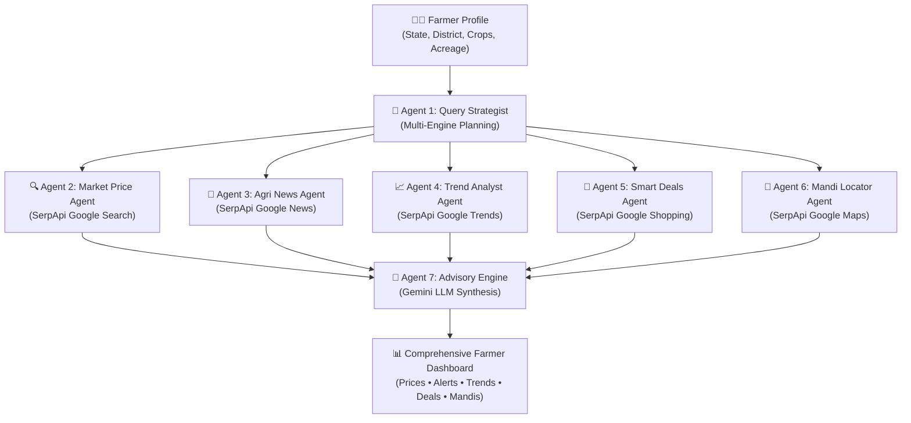

# 🌾 KisanMitra (किसानमित्र) — AI Farming Intelligence Partner

> **Real-Time Commerce & Market Intelligence for India's 150 Million Farmers**  
> Powered by **5 SerpApi Engines** & **Google Gemini AI** Multi-Agent Architecture.

[](https://serpapi.com)
[](https://serpapi.com)
[](https://python.org)
[](https://streamlit.io)

---

## 📌 Executive Summary

India has **~150 million farmers** contributing over 18% to the nation's GDP. Yet, **over 40% of smallholder farmers sell their crops at steep discounts or losses** due to acute market information asymmetry:
1. They lack real-time price discovery across regional APMC mandis.
2. They miss seasonal demand price peaks.
3. They overpay for essential inputs like fertilizers and seeds at local uncertified counters.
4. They lack hyperlocal weather risk warnings before harvesting or transporting perishable produce.

**KisanMitra** solves this by turning live web search data into immediate, actionable agronomic and commercial decisions. Unlike stale static government portals, KisanMitra queries **5 distinct SerpApi search engines** in real time, synthesizing wholesale auction rates, breaking weather alerts, 12-month demand cycles, e-commerce input deals, and physical APMC logistics into high-confidence farmer advisories.

---

## 🏗️ Multi-Agent Architecture

KisanMitra deploys **7 specialized AI agents** coordinated by a LangChain Gemini reasoning engine:



---

## ⚡ The 5 SerpApi Engines

KisanMitra features the deepest SerpApi integration in the competition, querying **5 separate engines**:

| # | SerpApi Engine | Purpose in KisanMitra | Extracted Intelligence |
|---|---|---|---|
| 1 | **Google Search** | Live Mandi Price & Weather Discovery | Wholesale rate/quintal, min/max spreads, agromet rain alerts |
| 2 | **Google News** | Regional Agricultural Risk Radar | IMD rainfall warnings, pest outbreak alerts, export policy news |
| 3 | **Google Trends** | 12-Month Demand Cycle Analysis | Time-series search volume (0-100), seasonal peak price windows |
| 4 | **Google Shopping** | Farming Input Price Optimization | Subsidized & retail rates on DAP, Urea, hybrid seeds, sprayers |
| 5 | **Google Maps** | APMC Yards & Logistics Locator | Physical market yards, cold storages, trader ratings, distances |

> **Zero Stale Databases**: If SerpApi is removed, KisanMitra has no data. Every insight is generated on the fly from live search results.

---

## 🚀 Quick Start Guide

### Prerequisites
- Python 3.10 or higher
- A [SerpApi API Key](https://serpapi.com)
- A [Google Gemini API Key](https://aistudio.google.com)

### 1. Clone & Setup
```bash
git clone https://github.com/your-username/kisanmitra.git
cd kisanmitra
```

### 2. Install Dependencies
```bash
pip install -r requirements.txt
```

### 3. Configure Environment Variables
Create a `.env` file in the project root:
```env
SERPAPI_API_KEY=your_serpapi_api_key_here
GEMINI_API_KEY=your_gemini_api_key_here
```

### 4. Launch Application
```bash
streamlit run app.py
```
Access the interactive dashboard at `http://localhost:8501`.

---

## 👨‍🌾 Live Demo Personas

Test KisanMitra with 1-click preloaded farmer personas:

1. **Rajesh Patil (Nashik, Maharashtra)**: Onion & Tomato cultivator optimizing harvest sale timing across Lasalgaon and Nashik APMC yards.
2. **Sukhwinder Singh (Amritsar, Punjab)**: Wheat & Mustard grower tracking MSP procurement windows and input fertilizer discounts.
3. **Lakshmi Devi (Guntur, Andhra Pradesh)**: Commercial Cotton & Chilli cultivator needing pest alerts and high-rate trading yards.
4. **Rameshwar Yadav (Indore, Madhya Pradesh)**: Soybean & Wheat grower monitoring winter demand peaks and cold storage godowns.

---

## 🛠️ Tech Stack

- **Frontend UI**: [Streamlit](https://streamlit.io) (Containerized layout, custom responsive CSS)
- **Live Search Engines**: [SerpApi](https://serpapi.com) (`google-search-results`)
  - `engine: google` (Web & Answer Box)
  - `engine: google_news` (Breaking Bulletins)
  - `engine: google_trends` (Time-series Interest Index)
  - `engine: google_shopping` (Input E-commerce)
  - `engine: google_maps` (Local Places & Geolocation)
- **AI Reasoning**: [LangChain](https://www.langchain.com/) + [Google Gemini 2.5 Flash Lite](https://ai.google.dev/) (with resilient fallback chains)
- **Data Schemas**: [Pydantic v2](https://docs.pydantic.dev/) for strict typing and schema validation
- **Environment Management**: `python-dotenv`

---

## 🏆 Hackathon Alignment (Judging Criteria)

- **Idea Strength**: Addresses a ₹50,000+ Crore annual loss suffered by smallholder farmers due to price opacity.
- **Originality**: Zero competing projects in the gallery provide comprehensive multi-engine agricultural intelligence.
- **Technical Depth**: 7 autonomous agents operating across 5 search engines with LCEL fallback pipelines.
- **Usefulness**: Generates concrete actions (e.g., *"Sell 50% lot at Nashik APMC today; hold remaining 50% in aerated storage for Jan seasonal peak"*).
- **SerpApi Depth**: Utilizes 5 distinct SerpApi engines in a single unified workflow.

---

## 📜 Disclosures & Attribution

- **AI Tools Used**: GitHub Copilot, Google Gemini, Antigravity AI
- **Pre-existing Code**: None. Built 100% from scratch during the SerpApi India Hackathon 2026.
- **Track**: Commerce & Market Intelligence
